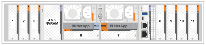

= AFF A1K システムでの I/O モジュールの追加と交換について
:allow-uri-read: 
:icons: font
:imagesdir: ../media/

[role="lead"]
AFF A1Kシステムは、I/Oモジュールを拡張または交換することで、ネットワーク接続性とパフォーマンスを向上させる柔軟性を備えています。ネットワーク機能をアップグレードする際には、I/Oモジュールを追加することが不可欠です。故障したモジュールに対処するには、I/Oモジュールを交換することが不可欠です。

AFF A1Kストレージシステム内の障害が発生したI/Oモジュールは、同じタイプのI/Oモジュールに交換することも、別の種類のI/Oモジュールに交換することもできます。空きスロットのあるシステムにI/Oモジュールを追加することもできます。

* link:io-module-add.html["I/Oモジュールの追加"]
+
モジュールを追加すると、冗長性が向上し、1つのモジュールに障害が発生してもシステムが動作し続けるようになります。

* link:io-module-hotswap.html["I/O モジュールのホット スワップ"]
+
I/O モジュールのホット スワップを使用すると、システムをシャットダウンせずに障害が発生したモジュールを交換できるため、ダウンタイムを最小限に抑え、システムの可用性を維持できます。

* link:io-module-replace.html["I/Oモジュールの交換"]
+
障害が発生したI/Oモジュールを交換すると、システムを最適な動作状態に戻すことができます。

.I/Oスロット番号I/Oスロットバンゴウ
次の図に示すように、AFF A1KコントローラのI/Oスロットには1~11の番号が付けられています。

