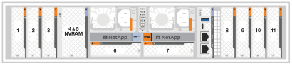

= AFX 1KシステムにおけるI/Oモジュールの追加と交換について
:allow-uri-read: 
:icons: font
:imagesdir: ../media/

[role="lead"]
AFX 1Kストレージシステムは、I/Oモジュールの拡張や交換を柔軟に行えるため、ネットワーク接続性とパフォーマンスを向上させることができます。ネットワーク機能をアップグレードする際には、I/Oモジュールを追加することが不可欠です。故障したモジュールに対処するには、I/Oモジュールを交換することが不可欠です。

AFX 1K ストレージ システム内の障害が発生した I/O モジュールを、同じタイプの I/O モジュールまたは異なる種類の I/O モジュールに交換できます。空きスロットのあるシステムに I/O モジュールを追加することもできます。

* link:io-module-add.html["I/Oモジュールの追加"]
+
モジュールを追加すると、冗長性が向上し、1つのモジュールに障害が発生してもシステムが動作し続けるようになります。

* link:io-module-replace.html["I/Oモジュールの交換"]
+
障害が発生したI/Oモジュールを交換すると、システムを最適な動作状態に戻すことができます。

.I/Oスロット番号I/Oスロットバンゴウ
AFX 1K コントローラーの I/O スロットには、次の図に示すように 1 ～ 11 の番号が付けられています。

