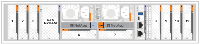

= FAS70またはFAS90システムにおけるI/Oモジュールの追加と交換について
:allow-uri-read: 
:icons: font
:imagesdir: ../media/

[role="lead"]
FAS70またはFAS90システムは、I/Oモジュールの拡張や交換において柔軟性を備えており、ネットワーク接続性とパフォーマンスを向上させることができます。ネットワーク機能をアップグレードする際には、I/Oモジュールを追加することが不可欠です。故障したモジュールに対処するには、I/Oモジュールを交換することが不可欠です。

FAS70またはFAS90ストレージ・システム内の障害が発生したI/Oモジュールは、同じタイプのI/Oモジュールに交換することも、別の種類のI/Oモジュールに交換することもできます。空きスロットのあるシステムにI/Oモジュールを追加することもできます。

* link:io-module-add.html["I/Oモジュールの追加"]
+
モジュールを追加すると、冗長性が向上し、1つのモジュールに障害が発生してもシステムが動作し続けるようになります。

* link:io-module-hotswap.html["I/O モジュールのホット スワップ"]
+
特定のI/Oモジュールを同等のI/Oモジュールとホット スワップすることで、ストレージシステムを最適な動作状態に復元できます。ホット スワップは、手動でテイクオーバーを実行することなく実行できます。

この手順を使用するには、ストレージ システムでONTAP 9.18.1以降が実行されている必要があります。

* link:io-module-replace.html["I/Oモジュールの交換"]
+
障害が発生したI/Oモジュールを交換すると、システムを最適な動作状態に戻すことができます。

.I/Oスロット番号I/Oスロットバンゴウ
FAS70およびFAS90コントローラのI/Oスロットには、次の図に示すように1～11の番号が付けられています。

